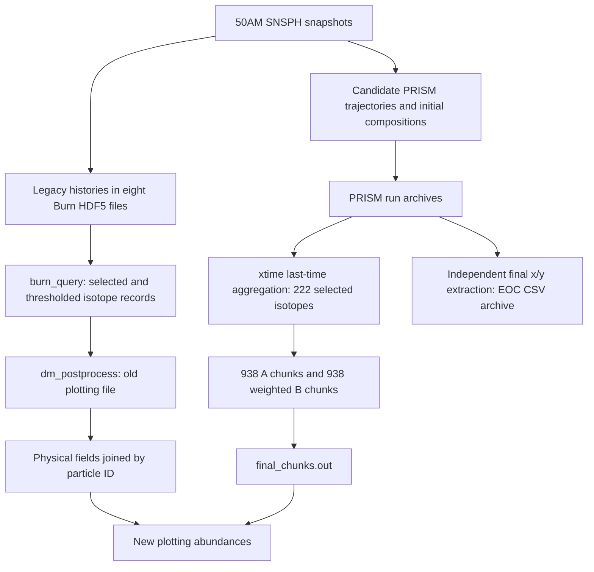

# Nuclear-network and processing provenance

## Evidence and search scope

The complete recursive metadata traversal covered 19,249,821 files, 1,956,345 directories and 14 symlinks under `/scratch/svierlin`, `/scratch/pyoung3`, `/data/pyoung3` and `/home/pyoung3`. `/home/pyoung3` was inaccessible; symlink targets were recorded without traversing them. A subsequent content search examined 3,243 small Python, shell, notebook and Fortran files. These are explicit scopes, not a claim to have inspected the contents of every group file. Full inventories, errors, source fingerprints and match locations are retained in `provenance/`.

The two legacy plotting copies under `/data/pyoung3/supernova_data/50Am/analysis/` and `/data/pyoung3/gsvance/supernova_data/50Am/analysis/` have identical SHA-256 hashes. Their inodes differ. A separate `50AmP` PRISM workflow also exists; its teammate scripts reference the unavailable historical `/home/gsvance/prismtools` path. It is not assumed to be Sarah's run. Direct ID 7753 files found in `jet3b_outputs` belong to another model and were not substituted for 50AM data.

The published model description identifies 50Am with 15S and describes TYCHO progenitors, neutrino-driven explosion treatment, SNSPH hydrodynamics and Burn postprocessing. This supports model nomenclature; it does not authenticate the particular files examined here. [Schulte et al., model methods](https://arxiv.org/pdf/2011.07459).

## Reconstructed processing chains

The original hydro simulation and tracer extraction build are not fully pinned. The stored legacy histories and full candidate trajectory population were independently checked against the original SDF snapshots, providing numerical lineage beyond filenames or modification dates.

| Stage | Identified evidence | Qualification |
| --- | --- | --- |
| Native hydro | `/data/pyoung3/supernova_data/50Am/run3g_50Am6/`, 61 snapshots | Native initial/final physical fields checked over all 945,628 IDs |
| Legacy network | `/data/pyoung3/supernova_data/50Am/50Am.dir/out501.h5` through `out508.h5` | 277,510 unique stored IDs, identical 524-species Z/N arrays |
| Legacy source | `/data/pyoung3/burn/src/fnuclear.f`, `worker.f`; available `netsu.524`, `netweak.524`, `netwinv.524`, `nuc.in` and setup files | Current source/library availability does not prove the historical executable or input hashes |
| Legacy extraction | `/data/pyoung3/gsvance/data_mining/burn_query.c`, `run_query.py`, `dm_postprocess.py`, `particler.py`, `sn_utils.py`; original sbatch files | Query cutoff is configurable. An archived 26Al submission specifies `-a 12`; later query revisions and per-isotope cutoffs must not be inferred from that alone |
| New trajectories | `/scratch/svierlin/prism-v02/input/conditions/50Am_output.zip` and `50Am_output_tempcorr.zip` | Corrected archive comprehensively checked; controls point at a mutable unpacked path |
| New seeds | `/scratch/svierlin/prism-v02/input/conditions/50Am_abund.zip` | All 943,900 files inspected, closure/Ye and native shared species compared; original seed-generation script/run binding unresolved |
| PRISM code/config | `/scratch/svierlin/prism-v02/src/`, nine archived `control.json` files, current nuclear input files | Hashes retained; exact historical build and all-particle controls not recovered |
| PRISM outputs | Ten `eoc_batch_*.tar.gz` archives under `/data/pyoung3/groupdata/svierlin/50Am_data/` | Roughly 2.5 TB compressed; only bounded first-particle prefixes inspected, not full archive integrity |
| Independent final derivative | `/scratch/svierlin/prism-v02/EOC_csv.tar.gz`, produced by `EOC_compile.sh` | Entire archive processed: 938,732 IDs; producer skips existing CSVs, so stale/mixed revisions remain possible |
| Chunk producer | `/scratch/svierlin/prism-v02/sum_eoc_manifest_RP.sh` | Fixed 222-species selection; missing entries become printed zero; repeated time keys are summed |
| New exporter | `/scratch/rpraka15/final_chunks_export_20261018/make_plotting_format.py` | Physical fields copied from old file by ID; last-category chunk abundance used |

## Network and numerical settings

The legacy raw species inventory has 524 distinct (Z,A) entries. The currently available PRISM extent contains 13,396 permitted entries, Z=0 through 133. This is a configured extent, not a measurement of how many species were active in every historical calculation. All nine recovered controls share one nuclear-dataset configuration. Their 33 referenced current input files, including the extent, are readable and hashed. The active datasets reference Reaclib, Moller2003, NDI FRDM2012/AME2016 reaction and decay products, and NUBASE2016 decay/stability information. Paths and activation flags are preserved verbatim in `archived_control_records.json`.

Current PRISM `control.f90` defaults include initial timestep 1e-15 s, `minimum_mass_conservation=1e-8`, `nuc_mass_check=1e-3`, abundance threshold −1 and screening false unless overridden. These are source defaults, not a retrospectively verified solver configuration for every tracer. `progression.f90` normalizes initial X and computes evolving composition Ye for rate evaluation. `trajectory.f90` uses linear interpolation and holds endpoint temperature/density constant beyond the supplied interval. Archived controls specify stop times 2000 s for one inspected tracer and 166000 s for eight; the tenth prefix lacks a recovered control. Actual runtime headers corroborate the mixed endpoints.

The output schema identifies nuclides by Z/A, with no separate 26Al ground/isomer columns. No state-resolved 26Al ratio can be extracted from these tables. Exact legacy versus PRISM rate-library revisions, NSE prescriptions, partition functions, historical screening/weak/neutrino settings and solver builds remain insufficiently pinned for a controlled physics attribution. Existing source is evidence of available implementations, not proof that every feature was active. [PRISM-related methods paper](https://arxiv.org/abs/2008.06075).

The available PRISM output default lower bound is 1e-15, applied separately to X and Y. This explains why a CSV inventory row can have X or Y unavailable and why selected-species zero filling loses information. Original thresholds are part of output provenance, not a threshold applied by this audit. Where both are finite, all 111,953,173 EOC pairs satisfy X=A Y within relative tolerance 1e-12. In the legacy raw-to-plotting audit, all 17,760,640 paired cells for 64 species are explained by query rounding or positive-to-zero censoring. The latter affects 6,003,121 cells, with omitted values approaching 1e-6. The old 10Be plotting column has no counterpart in the stored legacy network; 10Be and 16N are present in the EOC inventory but absent from that legacy network.

## Earliest demonstrated divergence

1. The candidate PRISM seed compositions already differ from native initial SNSPH compositions before any new network integration. The native network is approximate, so modest species differences can be expected; large H/He-to-O differences require a seed-mapping explanation.
2. All corrected candidate histories preserve the hydro temperature sequence but substitute snapshot iteration for physical time and retain native density under a cgs label. Ten archived runtime prefixes numerically tie this behavior to actual new abundances.
3. Legacy raw records contain failure-associated status flags and 22 particles with inconsistent stored temperature/density histories. Missing raw results are then represented as zero in the old plotting output.
4. The selected new chunks reproduce the plotting file exactly, but 176 particles disagree with independent final EOC abundances. Their original 50AM time series and run identities are needed to distinguish incomplete histories, later restarts, stale final derivatives and repeated-time summation.

The same directory contains scripts for restarting from last saved abundances, replacing trajectory starts, and moving revised inputs. Their existence supports a revision risk but does not establish that a specific script caused a particular discrepancy. The inaccessible `eoc_manifest.txt` and absent unpacked `all_outputs/` prevent a full manifest-to-run binding. No group source or research data was altered.
